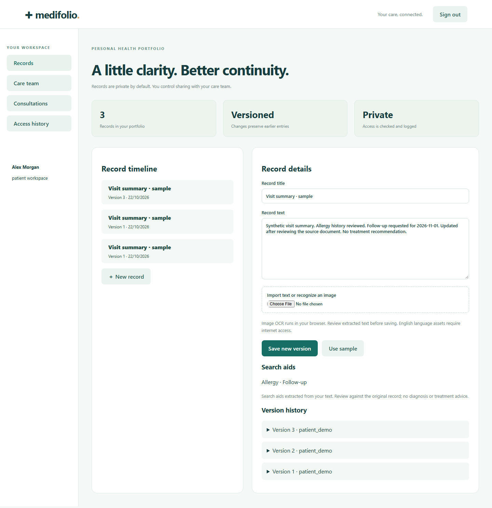
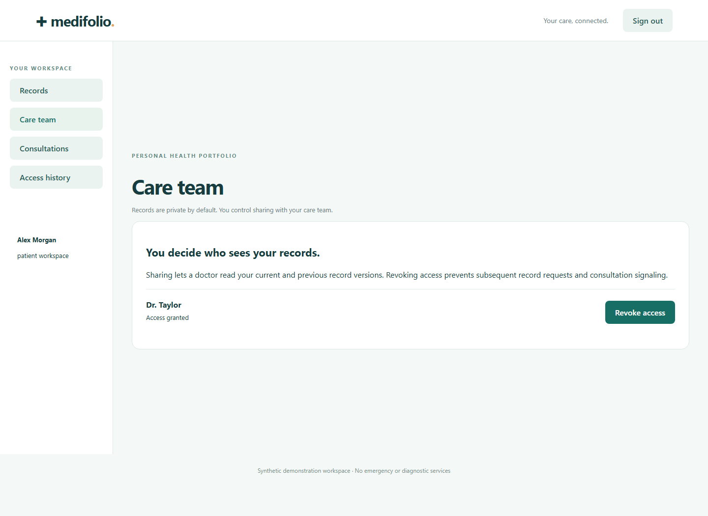
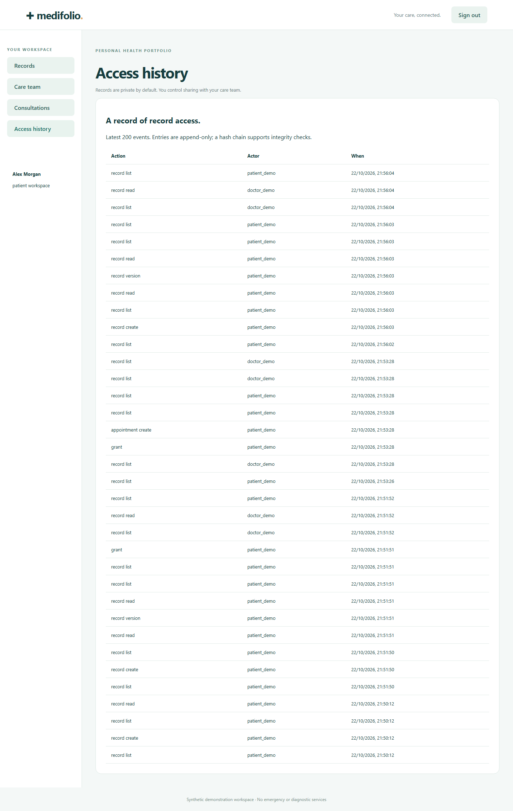
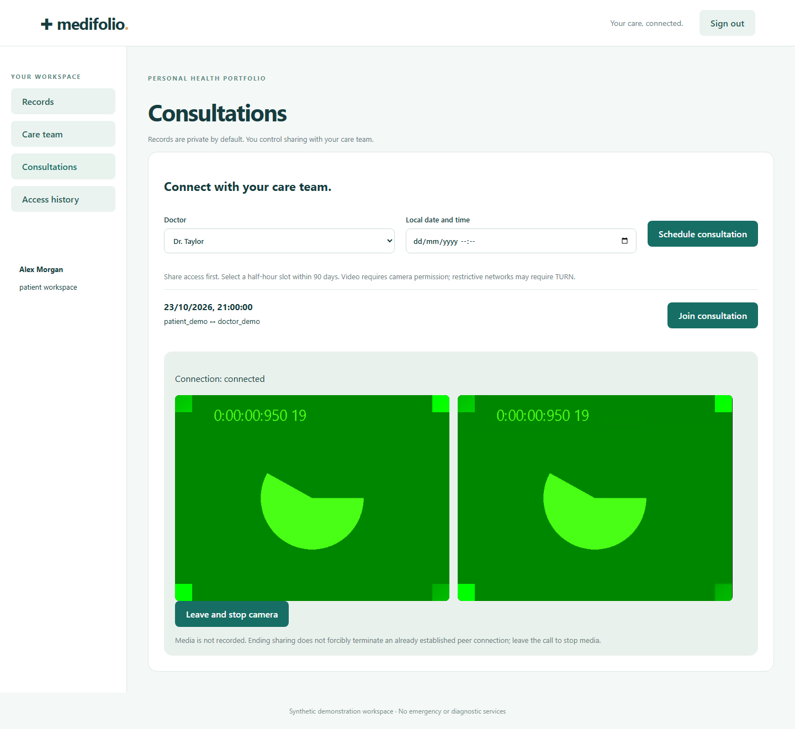
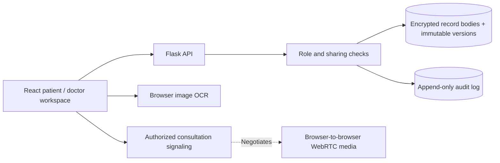

# Medifolio

**A clearer record of care, with sharing you can inspect.**

A React/Flask portfolio platform for versioned medical record text, browser image OCR, patient-controlled sharing, access auditing, and private WebRTC consultations. Use synthetic records only. No diagnostic, treatment, regulatory compliance, or clinical-readiness claim is made.

## Interface



<details>
<summary>Sharing, access history, and a tested consultation</summary>







These are actual local application screenshots with synthetic records and simulated camera devices. They demonstrate the local workflow, not clinical use or connectivity across every network.

</details>

## Architecture



## Start locally

Requires Python 3.12 and Node.js 22. From the repository root:

```bash
python -m venv .venv
# Windows: .venv\Scripts\activate
# macOS/Linux: source .venv/bin/activate
python -m pip install -r requirements.txt
npm --prefix frontend ci
npm --prefix frontend run build
python -m backend.manage --demo
python run.py
```

The provisioning command asks you to choose a password and creates `patient_demo` and `doctor_demo`. It does not embed a public default password. Open http://127.0.0.1:5001 and use those accounts in separate browser profiles to test sharing and consultations.

## Review the complete workflow

1. Sign in as the patient. Choose **Use sample**, review the synthetic text, and save a record.
2. Open that record, change its text, and save a new version. Earlier versions remain visible.
3. Open **Care team** and grant the doctor access. In another browser profile, sign in as the doctor and read the shared record.
4. Return to the patient’s **Access history** to see the read event. Revoke access and verify that subsequent doctor requests are denied.
5. Grant access again, schedule a half-hour consultation within the next 90 days, and join it from both profiles. Camera/microphone permissions are required.

## Engineering features

| Area | Behavior |
| --- | --- |
| Authorization | Provisioned patient, doctor and admin roles; patients own records; doctors require explicit grants; admin does not imply record access |
| Versions | Append-only record versions with optimistic concurrency; stale edits return 409 |
| Storage | SQLite WAL and encrypted record bodies using Fernet; session and encryption keys persisted outside version control |
| Audit | Append-only access/change entries with a hash chain; database triggers reject updates and deletion |
| Text indexing | Rule-based keyword, date and dose-mention extraction for search aids, explicitly not clinical interpretation |
| Image recognition | English browser OCR for PNG/JPEG; extracted text must be reviewed before saving; raw images are not uploaded |
| Consultations | Appointment-scoped signaling, participant checks, grant/session validation, browser WebRTC and explicit camera shutdown |
| Delivery | Docker multi-stage build, frontend lockfile, API/access-control regression tests, CI build and container readiness checks |

The text/title edit interface preserves historical versions. Titles, user names, timestamps, and audit metadata remain plaintext; encrypted bodies do not make the entire database encrypted. Back up the record encryption key with the database using a secure process. Losing the key makes bodies unreadable. The key must not be committed or sent to clients.

## Docker

```bash
docker compose up --build -d --wait
docker compose exec web python -m backend.manage --demo
```

Open http://127.0.0.1:5001. The named volume retains records and keys across restarts. Use HTTPS, secure cookies and controlled account provisioning for any remote environment. The provided Compose setup binds to loopback. One application process is supported; consultation signaling is in memory.

## Testing

```bash
python -m pytest -q
npm --prefix frontend run build
npm --prefix frontend audit --audit-level=high
```

Tests verify patient/doctor/admin isolation, explicit grants and revocation, immutable versions, stale-update rejection, ciphertext storage, audit-chain integrity, CSRF, session logout, appointment conflict handling and unauthorized consultation access. CI also builds and health-checks the container. Test data is synthetic.

## Media and data limits

- WebRTC needs a TURN relay on restrictive networks. Set `TURN_URL`, `TURN_USERNAME`, and `TURN_CREDENTIAL` through the server environment for a trusted relay. TURN credentials are delivered to authenticated browsers; use scoped, short-lived credentials for public deployments.
- Revocation blocks subsequent record requests and signaling. A peer media connection already established must be ended by leaving the call; it cannot be retroactively unshared.
- Image OCR runs locally but downloads public language/engine assets. Accuracy is not guaranteed; validate extracted text. PDF ingestion is not included: import plain text or a page image.
- No clinical image diagnosis, medication recommendation, insurance billing, recording, emergency care or compliance certification is claimed.
- Audit triggers and hash chains discourage accidental mutation; a database administrator who controls the database and keys can bypass them. External immutable audit storage is not implemented.
- The platform is not ready for real patient information without a separate security, privacy, legal and operational review.

## Provenance and repository layout

The project builds on the original React/Flask prototype in `Medical-Consultant/medical-consultant`, preserving its Git history and collaborators. `backend/platform_app.py`, `backend/records.py`, and `frontend/ui/` are the supported implementation. Historical prototype files remain for reference and are not the startup path. The unrelated coursework in `Shreeya1807/medifolio` is preserved separately.

## Container releases

A `v*` tag or manual release reruns the full CI workflow before publishing a commit-addressed image to GitHub Container Registry with provenance and a software bill of materials. No image is published from a failed verification run. Hosting still requires a compatible runtime and persistent storage where applicable; publishing an image is not a cloud deployment.
